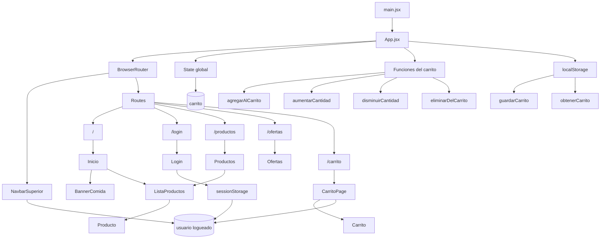

# Arquitectura de la app Food React

## 1) Objetivo general
La aplicación es una mini tienda de comida con carrito de compras, navegación por rutas y login básico. La lógica principal del carrito se centraliza en `App.jsx`, mientras que cada vista y componente reutilizable recibe props específicas.

---

## 2) Diagrama de arquitectura



---

## 3) Jerarquía de componentes

```text
App
├─ BrowserRouter
│  ├─ NavbarSuperior
│  │  ├─ logo / marca
│  │  ├─ links de navegación
│  │  ├─ contador del carrito
│  │  └─ cerrar sesión
│  │
│  ├─ main
│  │  └─ Routes
│  │     ├─ Route / → Inicio
│  │     │  ├─ BannerComida
│  │     │  └─ ListaProductos
│  │     │     └─ Producto
│  │     │
│  │     ├─ Route /login → Login
│  │     ├─ Route /productos → Productos
│  │     │  └─ ListaProductos
│  │     │     └─ Producto
│  │     ├─ Route /ofertas → Ofertas
│  │     └─ Route /carrito → CarritoPage
│  │        └─ Carrito
│  │           ├─ resumen
│  │           ├─ botones + / -
│  │           └─ eliminar producto
│
│  └─ Estado global
│     ├─ carrito
│     ├─ agregarAlCarrito()
│     ├─ aumentarCantidad()
│     ├─ disminuirCantidad()
│     └─ eliminarDelCarrito()
│
└─ Persistencia
   ├─ localStorage: carrito
   └─ sessionStorage: usuario
```

---

## 4) Responsabilidad de cada componente

### `main.jsx`
Es el punto de entrada. Monta la app en el `root` del HTML y carga Bootstrap.

### `App.jsx`
Es el componente principal de la aplicación.

Funciones principales:
- Mantiene el estado global del carrito con `useState`.
- Guarda el carrito en `localStorage` con `useEffect`.
- Carga el carrito desde `localStorage` al iniciar.
- Define las rutas con `BrowserRouter`, `Routes` y `Route`.
- Pasa props a las páginas y componentes.
- Centraliza todas las operaciones del carrito.

### `NavbarSuperior.jsx`
Es la barra superior de navegación.

Hace:
- muestra logo y menú principal
- cambia según si hay usuario logueado o no
- muestra contador del carrito
- permite cerrar sesión
- navega con `Link` y `useNavigate`

### `Inicio.jsx`
Vista principal.

Hace:
- si no hay usuario: muestra bienvenida y botón de login
- si hay usuario: muestra el banner y lista de productos
- reutiliza `ListaProductos`

### `Productos.jsx`
Vista del catálogo completo.

Hace:
- valida si existe usuario en `sessionStorage`
- renderiza `ListaProductos`

### `Ofertas.jsx`
Página de promociones.

Actualmente:
- solo muestra texto promocional
- no tiene lógica compleja de datos

### `Login.jsx`
Formulario de acceso.

Hace:
- captura usuario y contraseña en estado local
- usa el mismo formulario de usuario y contraseña para todas las cuentas
- valida las credenciales locales del administrador o de un usuario registrado
- guarda usuario y rol de la sesión en `sessionStorage`
- redirige administradores a `/admin` y usuarios a `/carrito`

### `ConfigurarAcceso.jsx`
Pantalla separada para definir por primera vez la contraseña de la cuenta administrativa. No forma parte del formulario normal de inicio de sesión y deja la sesión cerrada al terminar.

### `CarritoPage.jsx`
Es la pantalla del carrito con protección de acceso.

Hace:
- verifica si hay usuario logueado
- si no hay usuario, redirige a `/login`
- si hay usuario, renderiza `Carrito`

### `Carrito.jsx`
Componente visual del carrito.

Hace:
- muestra cada producto agregado
- calcula subtotal por producto
- calcula cantidad total
- calcula total general
- ofrece botones para +, -, eliminar
- muestra un resumen final

### `ListaProductos.jsx`
Lista reutilizable de productos.

Hace:
- recorre el array de productos
- renderiza un `Producto` por cada elemento

### `Producto.jsx`
Tarjeta individual de producto.

Hace:
- muestra nombre, emoji y precio
- tiene el botón “Agregar al carrito”
- dispara `agregarAlCarrito(producto)`

### `BannerComida.jsx`
Carrusel de imágenes con promociones.

Hace:
- muestra productos visualmente
- usa `react-bootstrap/Carousel`

### `DetalleProducto.jsx`
Vista de detalle del producto por ID.

Hace:
- lee el parámetro `id` de la URL
- busca el producto en `productos`
- muestra nombre y precio si existe
- si no existe, muestra un mensaje

### `NavbarLateral.jsx`
Sidebar de categorías.

Tiene un propósito visual y navegacional, pero no está activo en la estructura final de la app.

### `Titulo.jsx`
Componente simple para mostrar el título.

No está siendo usado en la app principal.

---

## 5) Estado global y persistencia

### Estado principal
El estado central del carrito está en `App.jsx`:

```jsx
const [carrito, setCarrito] = useState(obtenerCarrito());
```

Esto significa que:
- el carrito vive en el componente raíz
- todas las páginas lo usan por props
- cualquier cambio se refleja en toda la app

### Persistencia
Con `useEffect` se guarda cada cambio:

```jsx
useEffect(() => {
  guardarCarrito(carrito);
}, [carrito]);
```

Y se lee al iniciar:

```jsx
const [carrito, setCarrito] = useState(obtenerCarrito());
```

### Datos guardados
- `localStorage`: carrito comprado
- `sessionStorage`: usuario logueado

---

## 6) Flujos principales de la app

### Flujo 1: agregar producto al carrito
```text
Usuario hace click en "Agregar al carrito"
        ↓
Producto.jsx ejecuta agregarAlCarrito(producto)
        ↓
App.jsx revisa si el producto ya existe
        ↓
- si existe: suma cantidad
- si no existe: agrega nuevo item con cantidad = 1
        ↓
setCarrito(...) actualiza estado
        ↓
React renderiza la vista nuevamente
        ↓
localStorage se actualiza por useEffect
```

### Flujo 2: aumentar cantidad
```text
Usuario hace click en +
        ↓
Carrito.jsx llama a aumentarCantidad(id)
        ↓
App.jsx recorre el arreglo
        ↓
producto encontrado: cantidad + 1
        ↓
setCarrito(...) actualiza estado
```

### Flujo 3: disminuir cantidad
```text
Usuario hace click en -
        ↓
Carrito.jsx llama a disminuirCantidad(id)
        ↓
App.jsx resta 1 al producto
        ↓
si llega a 0, se elimina del carrito
        ↓
setCarrito(...) actualiza estado
```

### Flujo 4: configurar acceso inicial e iniciar sesión
```text
Primera configuración desde /configurar-acceso
        ↓
se crea la contraseña local de la cuenta administrativa
        ↓
las credenciales se guardan en localStorage
        ↓
se vuelve al formulario común de inicio de sesión
        ↓
se validan igual las credenciales administrativas y las cuentas registradas
        ↓
navigate("/admin") o navigate("/carrito")
```

### Flujo 5: proteger ruta /carrito
```text
CarritoPage se renderiza
        ↓
lee sessionStorage.getItem("usuario")
        ↓
si no existe: <Navigate to="/login" />
        ↓
si existe: renderiza Carrito
```

---

## 7) Hooks que usa React en la app

### `useState`
Usado para:
- `carrito`
- `usuario`
- `password`

### `useEffect`
Usado para:
- guardar el carrito en `localStorage` cada vez que cambie

### `useNavigate`
Usado para:
- redirigir al usuario después del login
- cerrar sesión

### `useParams`
Usado para:
- leer el ID del producto desde la URL

---

## 8) Acciones clave de React que hacen funcionar la app

- `useState`: define estado reactivo
- `setCarrito`: actualiza el carrito
- `setUsuario`: actualiza el nombre de usuario
- `setPassword`: actualiza la contraseña
- `useEffect`: reacciona al cambio del carrito
- `BrowserRouter`: habilita navegación SPA
- `Routes`: define páginas por URL
- `Route`: renderiza componente según la ruta
- `Link`: navega sin recargar
- `Navigate`: redirección forzada
- `useNavigate`: navegación programática
- `onClick`: manejo de clics
- `onChange`: manejo de inputs de texto
- `onSubmit`: manejo del envío del formulario

---

## 9) Conclusión
La arquitectura es simple y clara:
- App centraliza lógica
- componentes reutilizables muestran UI
- navegación se hace con React Router
- estado y persistencia están bien separados por capas
- el carrito funciona como flujo de datos centralizado y reactivo

Es una app muy buena para aprender arquitectura React básica, estado, rutas y almacenamiento local.
